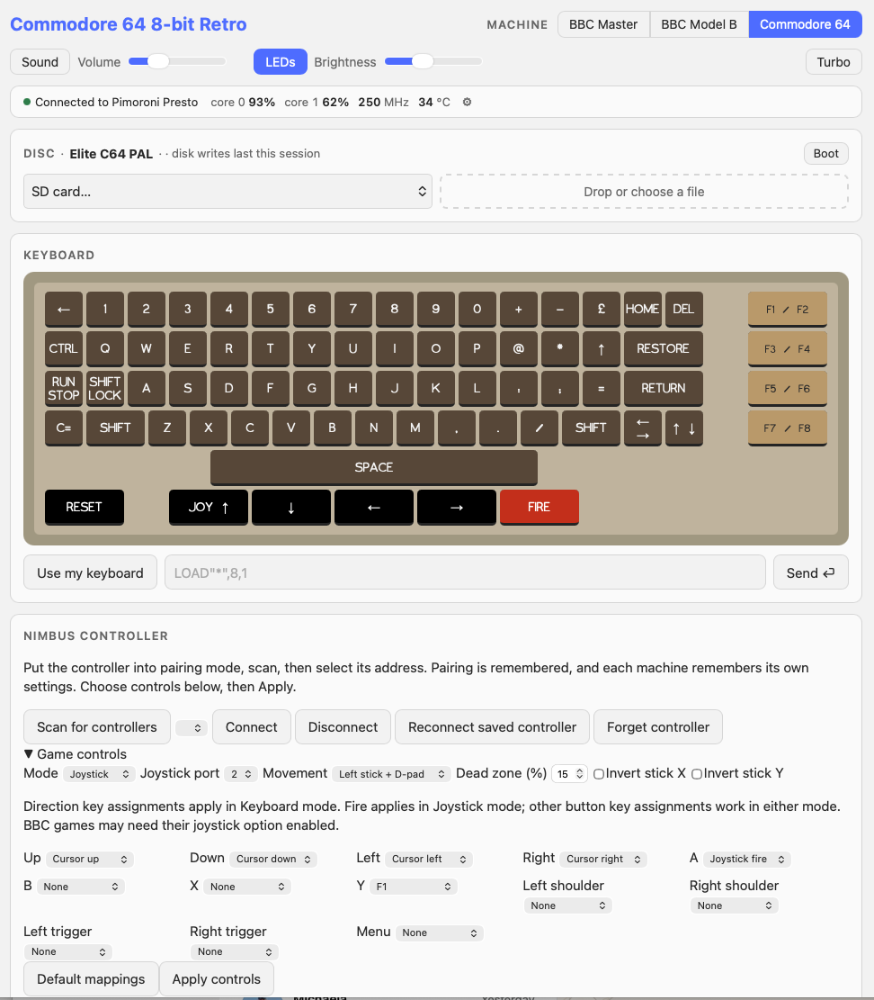
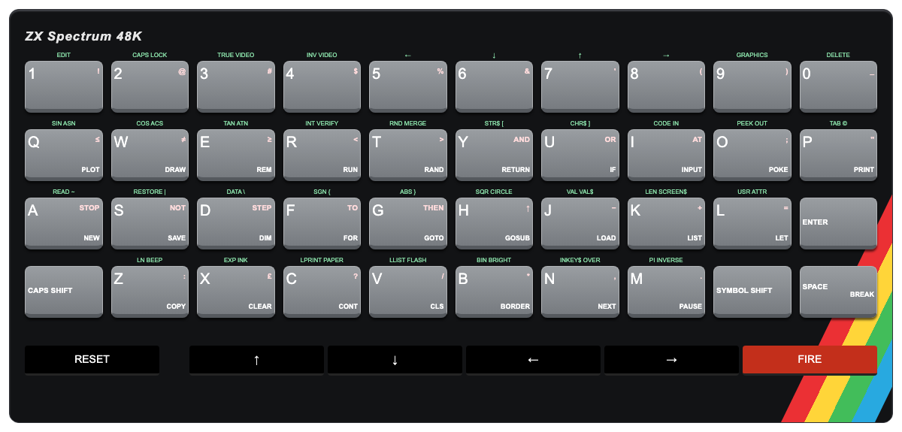

# RP2350 8-bit Retro

A multi-machine emulator platform for **Pimoroni Presto**, bringing the BBC Model B,
BBC Master 128, Commodore 64 and ZX Spectrum 48K together on one RP2350 board.

This project continues [8bitkick/rp2350-bbc-micro](https://github.com/8bitkick/rp2350-bbc-micro)
as a broader emulator platform. The original project remains focused on its BBC
experiment. Original Git history, source notices and licence files are retained.

## Download and try it

**[Download v0.6.0 firmware for Pimoroni Presto](https://github.com/andriodious/rp2350-8-bit-retro/releases/download/v0.6.0/rp2350-8-bit-retro-presto.uf2)** — no compilation required.

See the **[v0.6.0 release and first-time setup instructions](https://github.com/andriodious/rp2350-8-bit-retro/releases/tag/v0.6.0)** for flashing, Wi-Fi setup, source downloads and checksums. After flashing, open **http://8bitretro.local/** or the IP address shown at power-on. Existing Wi-Fi settings are retained.

## Machines and features

| Machine | Emulator foundation | Media support | Controller support |
|---|---|---|---|
| BBC Model B | beebjit, including the upstream RP2350 JIT work | BBC disk loading through SD/web | Analogue joystick/fire or keyboard mappings |
| BBC Master 128 | Kieran Connell's kc-beeb integration | BBC disk loading through SD/web | Analogue joystick/fire or keyboard mappings |
| Commodore 64 PAL | FRANK C64 / Frodo | D64/D81, T64/P00 programs and supported CRT cartridges through SD/web | Joystick port 1/2 or keyboard mappings |
| ZX Spectrum 48K | Pinned [chips fork](https://github.com/andriodious/chips) | SNA/Z80 snapshots and TAP/TZX tapes through SD/web | Kempston joystick/fire or keyboard mappings |

- Select the machine, load disks and use its keyboard from the web interface.
- Classic Bluetooth keyboard support on all four machines, with scanning, remembered pairing, automatic reconnection and up to 32 custom key mappings per machine.
- Sound output, volume controls and ambient LEDs on supported builds.
- Original SteelSeries Nimbus support: pairing, saved per-machine mappings,
  dead zone/inversion controls and reconnection across machine switches.
- Tested C64 optimisations: CPU/VIC code in SRAM, packed pixel conversion and
  overlapping emulation/display conversion. The RP2350 clock remains 250 MHz.

Version **v0.6.0** adds Classic Bluetooth keyboards alongside Nimbus, saved per-machine keyboard mappings, matching connection/scan controls, keyboard status on the startup/status screens, and C64 web function-key highlighting. All four machines were hardware-tested with reconnection, saved mappings, sound and web responsiveness.

Version **v0.5.0** adds the ZX Spectrum 48K, verified at 50 fps with Elite, with
beeper audio, a grey-key web keyboard on a black rainbow-striped case, and
Kempston controls. Reset returns to BASIC; Restart Elite loads the built-in snapshot.
Elite, Manic Miner TZX and YU_SKOOL TAP have been tested on hardware. This is a
48K machine; 128K snapshots and every possible TZX encoding are not supported.

Press **BOOT** for the SD chooser when a joystick is enabled and connected and
compatible titles are present on the SD card. Up/down browses; Nimbus **A** or
mapped Fire loads the selection. A second BOOT press shows status; a third returns
to the emulator. Without eligible titles/controller, BOOT toggles status directly.
Emulation pauses and audio is temporarily muted while these screens are open;
the web interface stays available. All four machines have been verified without
chooser/status flickering. Sound, volume, LEDs and brightness are remembered per
machine, alongside controller mappings.

Version v0.3.0 adds read-only C64 `.t64` loading from SD or web upload, with a program selector for multi-entry archives. See [T64 support and limitations](docs/c64-t64.md).

Current source also supports P00 programs and standard 8/16 KiB and EasyFlash CRT cartridges, with SD/web loading and cartridge eject. Tested on Presto with Commando P00 and Monkey Island EasyFlash. EasyFlash saves are not supported. See [cartridge and P00 support](docs/c64-cartridge-p00.md).

Pimoroni Presto is the first supported board. Nimbus validation is for the
**original Nimbus**, not Nimbus+ or arbitrary Bluetooth gamepads. Compatibility
with every game or disk fastloader is not guaranteed; for the supplied C64 Elite
image, choose **N** when asked to use its fastloader.


### On-screen keyboards

**Commodore 64** — front-face graphics, function keys and joystick controls.



**ZX Spectrum 48K** — grey keys, rainbow case stripe and Kempston controls.



## Gameplay videos

Recorded on Pimoroni Presto, with sound.

### Elite — Commodore 64

https://github.com/user-attachments/assets/acca71d1-84e7-4a5f-bc91-ceeebc5a8c98

### Ghosts ’n Goblins — Commodore 64

https://github.com/user-attachments/assets/c2f20f99-e762-4cea-ad45-c583d763a71b

### Repton 3 — BBC Master

https://github.com/user-attachments/assets/648c8668-27c7-495a-b540-f22d90917808

## Build on a Raspberry Pi or Linux computer

Start in the extracted release source folder or clone this repository:

```sh
git clone --branch v0.6.0 https://github.com/andriodious/rp2350-8-bit-retro.git
cd rp2350-8-bit-retro
```

```sh
scripts/setup.sh --no-build --roms
. deps/env.sh
scripts/build-classic-keyboard-four.sh build-release
```

On Debian/Raspberry Pi OS, add `--apt` to the setup command if host packages need
installing. Setup downloads the pinned compiler/SDK, BBC assets and dependencies;
C64 configuration fetches the pinned FRANK fork and checksum-verified Elite image.
Spectrum uses the pinned chips fork; its Elite snapshot is downloaded and checksum-verified during configuration, rather than stored in Git.
The source archive contains no downloaded game images, ROM set or Wi-Fi secrets.

Result: **`build-release/rp2350-8-bit-retro-presto.uf2`** containing the launcher and
all four machines. Sound, ambient LEDs, Classic Bluetooth keyboard and original Nimbus support are enabled;
profiling and web diagnostics are disabled. See [build instructions](docs/build-retro.md)
for options and an explanation of the legacy build entry points.

## Install and use

1. Hold the Presto's BOOT button, tap RESET and release BOOT to expose its USB drive.
2. Copy `rp2350-8-bit-retro-presto.uf2` to that drive.
3. Use the existing Wi-Fi setup procedure in [the Presto network guide](docs/presto/wifi.md)
   if Wi-Fi has not been configured. Existing Wi-Fi settings are retained.
4. Open `http://8bitretro.local/` or the device's IP address, then select a machine.

After flashing this version, use `8bitretro.local` instead of the previous
`beeb.local` or interim `retro8bit.local` address. Saved Wi-Fi credentials are retained.
The tested flash layout and machine identifiers remain compatible. Normal combined
builds do not include save-disk overwrite payloads. Saved Nimbus pairing and
profiles from test 3 onwards are retained. Refresh the browser after updating.

## Controller setup

In **Nimbus controller**, pair the original Nimbus once. Under **Game controls**,
choose Default mappings or configure your own, then Apply controls. Each machine
saves its own configuration. Defaults use left stick/D-pad and A for fire, BBC
joystick 1 or C64 port 2. Games may need their own joystick option enabled.

Reconnect is automatic for the remembered controller; one click on Reconnect
resumes it after an explicit Disconnect. Forget removes pairing but keeps mappings.
Machine switches cleanly close Bluetooth before restarting. See the detailed
[Nimbus notes](docs/nimbus-test.md) for controls, storage and diagnostics.

## Bluetooth keyboard setup

1. Disconnect the keyboard from other computers/tablets and put it in pairing mode (usually its Connect button).
2. Open **Bluetooth keyboard**, click **Scan for keyboards**, choose the matching name or address, then **Connect**. **Stop scan** ends discovery early. If a pairing PIN is shown, follow the displayed instructions.
3. The pairing is remembered. The keyboard and Nimbus reconnect independently after a power cycle or machine switch. A sleeping keyboard may need a keypress to wake before reconnecting. **Reconnect** resumes after an explicit Disconnect; **Forget** removes the remembered pairing.
4. Under **Key mappings**, click **Add mapping**, press a key on the Bluetooth keyboard, then click its destination on the emulator keyboard. Release the physical key after mapping. Choose a saved mapping and **Delete mapping** to restore that key's normal behaviour.

Mappings are saved separately for Master, BBC Model B, C64 and Spectrum. Up to 32
overrides are supported per machine; unmapped keys retain their default mapping.
Capture temporarily suppresses keyboard input and expires after 60 seconds;
Reset and joystick buttons are not mapping destinations.

This release supports **Classic Bluetooth HID keyboards**, not BLE-only keyboards.
A generic keyboard advertised as “Bluetooth Keyboard” was tested alongside an
original Nimbus. See [keyboard support and troubleshooting](docs/bluetooth-keyboard.md).

Settings are upgraded to integrity-checked v2 records. Older firmware may not read
these records, so rolling back can require re-pairing devices and restoring settings.

## Status and contributions

The v0.6.0 firmware is the exact clean GitHub build verified on all four machines,
from `reference/four-machine-clean-verified-20261114`. Keyboard and Nimbus
reconnection, retained mappings, C64 highlighting, sound and web responsiveness
were confirmed on Presto. See the [verification record](checkpoints/four-machine-clean-verified-20261114.md).
Compatibility with every game, Bluetooth keyboard or controller is not implied.

See [release notes](docs/releases/v0.6.0.md), [credits](CREDITS.md), and
[contribution guidance](CONTRIBUTING.md). The inherited [upstream README](UPSTREAM-README.md)
and technical documents remain available as historical and engineering references.

## Licences and assets

`LICENSE`, `COPYING`, component licence files and source headers are retained.
Different components carry their own terms; this project does not relicense them.
ROMs and Elite are separate copyrighted assets. Fetching or crediting them does
not change their ownership or grant new redistribution rights. Review the relevant
upstream notices before distributing firmware with embedded assets.

### Startup banner

A power-on screen shows the build, DHCP address, joystick and keyboard status. With Wi-Fi
configured it waits for an address, then holds it for two more seconds (30-second
network timeout); otherwise it shows for three seconds.
Machine switching skips the banner. See [startup banner details](docs/boot-banner.md).
