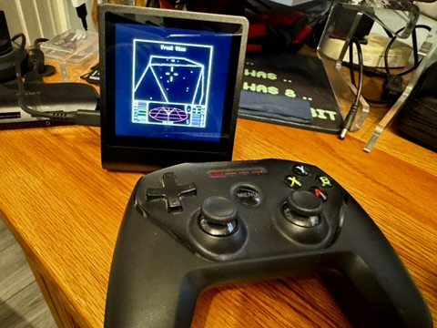

# RP2350 8-bit Retro

A multi-machine emulator platform for **Pimoroni Presto**, bringing the BBC Model B,
BBC Master 128 and Commodore 64 together on one RP2350 board.

This project continues [8bitkick/rp2350-bbc-micro](https://github.com/8bitkick/rp2350-bbc-micro)
as a broader emulator platform. The original project remains focused on its BBC
experiment. Original Git history, source notices and licence files are retained.

## Machines and features

| Machine | Emulator foundation | Disk support | Controller support |
|---|---|---|---|
| BBC Model B | beebjit, including the upstream RP2350 JIT work | BBC disk loading through SD/web | Analogue joystick/fire or keyboard mappings |
| BBC Master 128 | Kieran Connell's kc-beeb integration | BBC disk loading through SD/web | Analogue joystick/fire or keyboard mappings |
| Commodore 64 PAL | FRANK C64 / Frodo | D64/D81 loading through SD/web | Joystick port 1/2 or keyboard mappings |

- Select the machine, load disks and use its keyboard from the web interface.
- Sound output, volume controls and ambient LEDs on supported builds.
- Original SteelSeries Nimbus support: pairing, saved per-machine mappings,
  dead zone/inversion controls and reconnection across machine switches.
- Tested C64 optimisations: CPU/VIC code in SRAM, packed pixel conversion and
  overlapping emulation/display conversion. The RP2350 clock remains 250 MHz.

Pimoroni Presto is the first supported board. Nimbus validation is for the
**original Nimbus**, not Nimbus+ or arbitrary Bluetooth gamepads. Compatibility
with every game or disk fastloader is not guaranteed; for the supplied C64 Elite
image, choose **N** when asked to use its fastloader.



## Build on a Raspberry Pi or Linux computer

Start in an extracted source folder or a clone of this project. The intended
GitHub location is `andriodious/rp2350-8-bit-retro`; the repository rename/publication
is a separate step described in [project transition](docs/project-transition.md).

```sh
scripts/setup.sh --no-build --roms
. deps/env.sh
scripts/build-retro.sh
```

On Debian/Raspberry Pi OS, add `--apt` to the setup command if host packages need
installing. Setup downloads the pinned compiler/SDK, BBC assets and dependencies;
C64 configuration fetches the pinned FRANK fork and checksum-verified Elite image.
The source archive contains no downloaded game images, ROM set or Wi-Fi secrets.

Result: **`build-retro/rp2350-8-bit-retro-presto.uf2`** containing the launcher and
all three machines. Sound, ambient LEDs and original Nimbus support are enabled;
profiling and web diagnostics are disabled. See [build instructions](docs/build-retro.md)
for options and an explanation of the legacy build entry points.

## Install and use

1. Hold the Presto's BOOT button, tap RESET and release BOOT to expose its USB drive.
2. Copy `rp2350-8-bit-retro-presto.uf2` to that drive.
3. Use the existing Wi-Fi setup procedure in [the Presto network guide](docs/presto/wifi.md)
   if Wi-Fi has not been configured. Existing Wi-Fi settings are retained.
4. Open `http://beeb.local/` or the device's IP address, then select a machine.

The hostname intentionally remains `beeb.local` for existing installations.
The tested flash layout and machine identifiers remain compatible. Normal combined
builds do not include save-disk overwrite payloads. Saved Nimbus pairing and
profiles from test 3 onwards are retained. Refresh the browser after updating.

## Controller setup

In **Nimbus controller**, pair the original Nimbus once. Under **Game controls**,
choose Default mappings or configure your own, then Apply controls. Each machine
saves its own configuration. Defaults use left stick/D-pad and A for fire, BBC
joystick 1 or C64 port 2. Games may need their own joystick option enabled.

Reconnect is automatic for the remembered controller; one click on Reconnect
resumes it after an explicit Disconnect. Forget removes pairing but keeps mappings.
Machine switches cleanly close Bluetooth before restarting. See the detailed
[Nimbus notes](docs/nimbus-test.md) for controls, storage and diagnostics.

## Status and contributions

The clean release is based on hardware-tested C64 optimisations and Nimbus test 5.
The user confirmed switching, reconnecting and restoring controls. Local checks
cover builds, firmware packaging, storage boundaries, interrupted writes and input
mapping. Those checks are not a claim that every game or controller is supported.

See [release notes](docs/releases/retro-initial.md), [credits](CREDITS.md), and
[contribution guidance](CONTRIBUTING.md). The inherited [upstream README](UPSTREAM-README.md)
and technical documents remain available as historical and engineering references.

## Licences and assets

`LICENSE`, `COPYING`, component licence files and source headers are retained.
Different components carry their own terms; this project does not relicense them.
ROMs and Elite are separate copyrighted assets. Fetching or crediting them does
not change their ownership or grant new redistribution rights. Review the relevant
upstream notices before distributing firmware with embedded assets.
