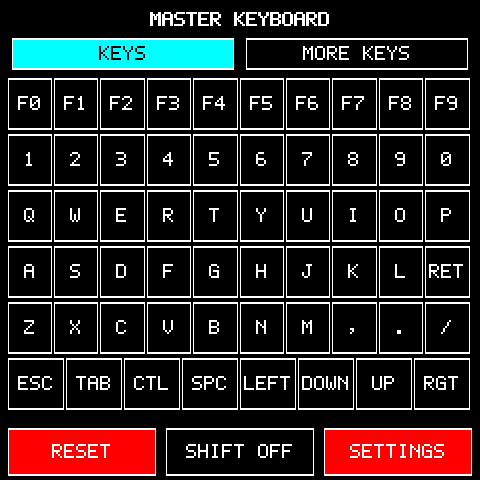
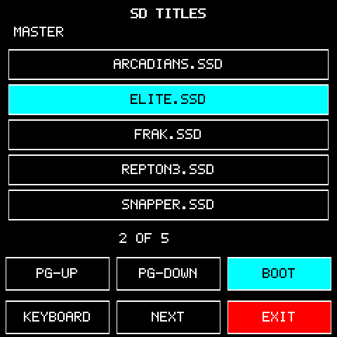
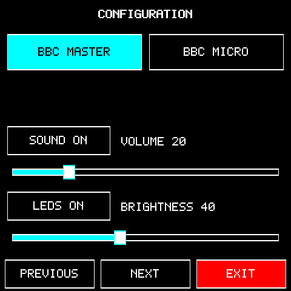
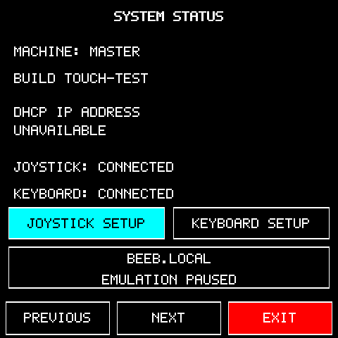

# Presto startup status screen

On power-on, the BBC Model B and Master show the supplied owl graphic, source build
ID, build date/time, DHCP progress and IP address, joystick and keyboard status,
and **WEB: BEEB.LOCAL**. Open `http://beeb.local/` in a browser on the same network
once the emulator starts; use the displayed IP address if mDNS is unavailable.
This is the local web interface, not an Internet service.

The banner remains for at least three seconds. With saved Wi-Fi credentials it
waits up to 30 seconds for an address, or two seconds after the address appears.
No network, a failed join or an allocation failure prevents the emulator from
starting. Watchdog restarts (including web machine switches) skip the banner.

Bluetooth is optional. Without
that build option both input lines say **DISABLED IN BUILD**. With it, they show
live connection progress. The banner polls Bluetooth without writing pairing
flash: core 1 may not yet be ready for flash lockout. Connection retries continue
normally after the emulator starts.

The two temporary packed-pixel images reuse the idle disc-upload staging area.
Repeated rows are packed into immutable SRAM banks for scanout; the Model B
borrows and restores its framebuffer when runtime menus are enabled.
HTTP uploads start only after the banner releases it. Status updates draw into
the inactive buffer, wait for two display frames before reusing the previous
one, and restore the original display table before releasing the pointer tables.
The power-on banner does not change CPU emulation, the render pipeline, JIT or
save-disc layout. Runtime BOOT controls are described below.

The owl in `assets/boot-owl.png` is user-supplied artwork. Its aspect ratio is
preserved. `tools/embed_boot_logo.py` regenerates the checked-in header with
Pillow; normal firmware builds do not need Pillow.

Validation:

- `python3 tests/startup/test_banner.py` exercises the actual banner with simulated
  panel/network services, with and without Bluetooth hooks, under address and
  undefined-behaviour sanitizers: reset skip, offline timeout, DHCP, row end
  markers and original display restoration.
- Both Model B and Master firmware must build, with and without Bluetooth.
- Hardware acceptance: cold boot with/without Wi-Fi, readable stable banner,
  correct IP, browser access after boot, keyboard/Nimbus reconnection, normal
  gameplay and web machine switching. Host tests cannot verify panel tearing.

## Touchscreen and BOOT menus

With `BOOT_FILE_SELECTOR=ON` (default), touch the running emulator to open its
on-screen keyboard, or press BOOT to open the SD title chooser. No keyboard,
joystick or Wi-Fi connection is needed for touch control. Emulation pauses and
sound mutes temporarily; the web interface and Bluetooth remain active.

- **Keyboard:** tap a key to send one press and resume. **SHIFT** changes the
  displayed legends and sends a shifted press. **KEYS / MORE KEYS** expose the
  complete BBC keyboard (including the Master's keypad). **RESET** sends the
  usual emulator reset; **SETTINGS** opens the SD chooser. Cursor keys or Nimbus
  directions move the cyan highlight; Return or A/Fire presses the chosen key.
- **SD titles:** tap a filename to boot it, or use **PG-UP / PG-DOWN** to move five
  titles at a time and **BOOT** to load the highlight. Keyboard/Nimbus Up/Down
  selects individual rows; Left/Right changes pages. Return, keypad Enter or
  A/Fire loads the highlight. The first and last pages do not wrap.
- **Configuration:** choose **BBC Master** or **BBC Micro** in a dual-boot build.
  Choosing the running machine resumes it; another machine restarts through the
  launcher. The choice survives power-off. Sound and ambient LED toggles and
  sliders apply immediately, including LED changes while paused. With Bluetooth
  enabled in the build, these preferences are saved separately for each machine.
- **System status:** build, running machine, network, joystick and keyboard state,
  with **BEEB.LOCAL** and **EMULATION PAUSED** below. **JOYSTICK SETUP** and
  **KEYBOARD SETUP** provide the pairing and mapping controls described below.
- **PREVIOUS / NEXT / EXIT** navigate the pages or resume. On the SD page the
  first button is **KEYBOARD**. Physical BOOT cycles SD titles → configuration →
  status → emulator; from the keyboard or a setup page it returns to its parent.

These previews come from the actual Master renderer with simulated status and SD
contents; they are not photographs of hardware.

### Bluetooth setup

Build with `-DBLUETOOTH=ON` for Classic keyboard and original Nimbus support.
Both setup pages allow scanning, stopping a scan, choosing a discovered device,
connecting, disconnecting, reconnecting and forgetting a pairing. A keyboard PIN
is displayed when required. Disconnect the current device before pairing another.
Discovery requires the device's Connect/pairing mode.

Joystick **GAME CONTROLS** provides off/joystick/keyboard mode, port, left/right
stick or D-pad, axis inversion and dead zone. **BUTTON MAPPINGS** changes each
input's emulator key or Fire action. **APPLY** saves the changes; **DEFAULTS**
prepares defaults which must then be applied. Keyboard **KEY MAPPINGS** supports
adding (capture a Bluetooth key, then select its emulator key) and deleting
mappings. Controls are saved separately for Master and BBC Micro. Diagnostic
reports and downloads remain web-only.

Bluetooth initially waits for Wi-Fi to finish joining, but no saved credentials,
or a 30-second timeout releases both devices for offline use. A failed join
still waits for the full timeout. Bluetooth is powered up only after that gate
opens, preventing incoming connections and scans from bypassing the wait.

### Behaviour and resources

The keyboard's menu cursor/Enter actions use physical HID keys, independent of
saved emulator mappings. Menu input is captured and held controls must be
released before they reach the emulator again. Both input devices can be used
together. An installed app that owns touch for its own view retains that gesture;
BOOT still opens these menus.

Only files accepted by the existing BBC SD loader are listed, sorted by name,
up to 240 nonempty files no larger than its image limit. Subdirectories are not
browsed. An empty card displays an empty chooser; a failed load displays an error.
Titles use the existing loader and machine-safe reset mechanism.

The menu reserves 256 KiB at the top of PSRAM, outside both machine allocators.
Immutable scanout rows use about 46 KiB plus pointer tables. Master allocates
these on first use; Model B borrows and restores its idle framebuffer after
waiting for queued rendering to finish. Allocation failure leaves emulation
running. Display tables publish at vertical blank. Pause time is excluded from
emulation pacing, and settings saves preserve the active flash-read protocol.

`-DBOOT_FILE_SELECTOR=OFF` disables runtime BOOT/touch menus and their PSRAM
reservation; the power-on banner remains. With `BLUETOOTH=OFF`, touch keyboard,
file selection and configuration still work. Sound/LED controls require their
respective build options. The expanded touchscreen port was hardware verified on both BBC machines on
23 November 2026, including the Wi-Fi/Bluetooth startup wait fix (build
`bda7cd59c9ca`). Both machines operated as expected and touch controls passed.
